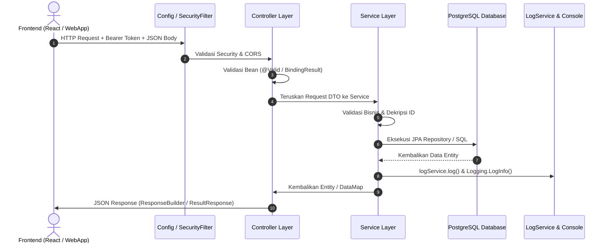

# DOKUMENTASI TEKNIS CODEBASE BACKEND
# SISTEM DIGITALISASI RUKUN TETANGGA (PAK RT)

**Versi:** 1.0  
**Stack Utama:** Java 21 (LTS), Spring Boot 3.3.2, PostgreSQL, Spring Data JPA, Hibernate, Spring Security  
**Arsitektur:** Nexus Multilateral Standard Architecture  

---

## **DAFTAR ISI**

- [BAB 1. Gambaran Umum Sistem & Arsitektur](#bab-1-gambaran-umum-sistem--arsitektur)
  - [1.1 Visi & Tujuan Produk](#11-visi--tujuan-produk)
  - [1.2 Struktur Hak Akses (RBAC)](#12-struktur-hak-akses-rbac)
  - [1.3 Tech Stack & Dependensi](#13-tech-stack--dependensi)
- [BAB 2. Arsitektur & Struktur Package](#bab-2-arsitektur--struktur-package)
  - [2.1 Gambaran Umum Struktur Folder](#21-gambaran-umum-struktur-folder)
  - [2.2 Alur Perjalanan Request API (Request Flow)](#22-alur-perjalanan-request-api-request-flow)
  - [2.3 Penjelasan Rinci Setiap Package](#23-penjelasan-rinci-setiap-package)
- [BAB 3. Standar & Fondasi Sistem](#bab-3-standar--fondasi-sistem)
  - [3.1 Standar Audit Trail Otomatis (`BaseAuditEntity`)](#31-standar-audit-trail-otomatis-baseauditentity)
  - [3.2 Modul User Log & Audit Aktivitas (`LogService` & `Logging`)](#32-modul-user-log--audit-aktivitas-logservice--logging)
  - [3.3 Lapisan Enkripsi Data Sensitif UU PDP (`CryptoJs` & `Encrypt`)](#33-lapisan-enkripsi-data-sensitif-uu-pdp-cryptojs--encrypt)
  - [3.4 Format Respon Standar API (`ResponseBuilder`, `ResultResponse`, `BasicResponse`)](#34-format-respon-standar-api-responsebuilder-resultresponse-basicresponse)
  - [3.5 Kamus Kode Respon Sistem (Response Code Dictionary)](#35-kamus-kode-respon-sistem-response-code-dictionary)
- [BAB 4. Skema Basis Data PostgreSQL](#bab-4-skema-basis-data-postgresql)
  - [4.1 Pemetaan Tabel Inti Sistem](#41-pemetaan-tabel-inti-sistem)
- [BAB 5. Panduan Pembuatan Modul / API Baru (Step-by-Step)](#bab-5-panduan-pembuatan-modul--api-baru-step-by-step)
  - [STEP 1: Model Entity (CRUD)](#step-1-model-entity-crud)
  - [STEP 2: Model List (Query & Enkripsi ID)](#step-2-model-list-query--enkripsi-id)
  - [STEP 3: Request DTO](#step-3-request-dto)
  - [STEP 4: Repository (CRUD & Specification)](#step-4-repository-crud--specification)
  - [STEP 5: Service (Business Logic, Audit & Log)](#step-5-service-business-logic-audit--log)
  - [STEP 6: Controller (REST API Layer)](#step-6-controller-rest-api-layer)
- [BAB 6. Konfigurasi Lingkungan & Menjalankan Proyek](#bab-6-konfigurasi-lingkungan--menjalankan-proyek)

---

## **BAB 1. Gambaran Umum Sistem & Arsitektur**

### **1.1 Visi & Tujuan Produk**
Aplikasi **Pak RT** adalah infrastruktur digital terpusat yang dirancang untuk mendigitalisasi operasional tata kelola Rukun Tetangga (RT) secara modern, transparan, dan aman.

Sistem ini berfokus pada:
1. **Digitalisasi Administrasi & Surat Dinamis**: Otomasi permohonan 11 jenis surat pengantar/keterangan berbasis konfigurasi parameter `JSONB` dan validasi tanda tangan digital QR Code.
2. **Transparansi Arus Kas Keuangan**: Pencatatan buku kas lingkungan yang dapat dipantau (*Read-Only*) oleh seluruh warga terdaftar secara real-time.
3. **Pemetaan Demografi & GIS**: Visualisasi koordinat tempat tinggal warga menggunakan OpenStreetMap (OSM) untuk validasi status domisili (*Warga Tetap*, *Pindah*, atau *Kontrak/Kost*).
4. **Kepatuhan Privasi Data (UU PDP)**: Proteksi data sensitif kependudukan (NIK, Nomor KK, Nomor WhatsApp) menggunakan enkripsi AES/CBC standar industri perbankan.

---

### **1.2 Struktur Hak Akses (RBAC)**

| Role | Aktor | Wewenang & Hak Akses |
| :--- | :--- | :--- |
| **Superadmin** | Ketua RT / Sekretaris | Kontrol mutlak, persetujuan surat keluar, manajemen master data, role mapping, dan mutasi warga. |
| **Admin Keuangan** | Bendahara RT | Akses penuh modul kas masuk/keluar, validasi bukti transfer/resi, dan publikasi laporan kas. |
| **Admin Lapangan** | Kader Dawis / Petugas | Validasi fisik demografi lapangan dan pemetaan titik koordinat GIS di wilayah tugas. |
| **User (Warga)** | Warga Terdaftar | Pengajuan surat, peminjaman inventaris RT, menerima notifikasi WhatsApp, dan melihat laporan transparansi kas. |

---

### **1.3 Tech Stack & Dependensi**

* **Bahasa Pemrograman**: Java 21 (LTS)
* **Framework**: Spring Boot 3.3.2
* **Persistence & ORM**: Spring Data JPA, Hibernate 6.5
* **Basis Data**: PostgreSQL 16+ (mendukung PostGIS & JSONB)
* **Security & Auth**: Spring Security 6 (Stateless / Bearer Token ready)
* **Enkripsi**: Custom AES/CBC/PKCS5Padding with SHA-256 Key Derivation
* **JSON Processing**: Jackson Datatype JSR-310 (`LocalDateTime`, `LocalDate`)
* **Utilities**: Project Lombok, SLF4J / Logback

---

## **BAB 2. Arsitektur & Struktur Package**

### **2.1 Gambaran Umum Struktur Folder**

```text
src/main/java/com/pakrt/pakrt/
│
├── 🔧 config/               ← Konfigurasi global aplikasi (Security, CORS, Jackson, Initializer)
├── 🌐 controllers/          ← Pintu masuk HTTP REST API Endpoint
├── 🔐 crypto/               ← Enkripsi komunikasi & payload data (AES/CBC)
├── 📦 models/               ← Entity JPA (Tabel DB) + Audit Base Entity
│   ├── audit/               ← BaseAuditEntity (created_at, created_by, updated_at, updated_by)
│   ├── log/                 ← UserLog (tabel user_logs)
│   ├── menu/                ← Menu, MenuDetail
│   └── warga/               ← Warga, KartuKeluarga, StatusKeluarga
├── 🗄️ repositories/         ← Akses basis data (Spring Data JPA & Specification)
│   ├── log/                 ← UserLogRepository
│   ├── menu/                ← MenuRepository, MenuDetailRepository
│   └── warga/               ← WargaRepository, KartuKeluargaRepository
├── 📥 request/              ← DTO (Data Transfer Object) penerima request dari klien
│   ├── menu/                ← MenuRequest, MenuDetailRequest
│   └── warga/               ← StatusKeluargaRequest, WargaRequest
├── 📤 responses/            ← Format pembungkus response API terstandarisasi
│   ├── BasicResponse.java   ← Response pesan sederhana {responseCode, responseMessage}
│   ├── ResultResponse.java  ← Response data objek/list {responseCode, responseData}
│   └── ResponseBuilder.java ← Shortcut helper pembangun ResponseEntity
├── ⚙️ services/             ← Lapisan Business Logic, Orkestrasi Data & Logging
│   ├── LogService.java      ← Service audit log aktivitas user
│   ├── MenuService.java
│   └── ...
├── 🛠️ utils/                ← Helper utilities (General, Logging, Encrypt, DataMap, MessageDictionary)
│
└── 🚀 PakrtApplication.java ← Entry Point aplikasi Spring Boot
```

---

### **2.2 Alur Perjalanan Request API (Request Flow)**



---

### **2.3 Penjelasan Rinci Setiap Package**

1. **`config/` (Konfigurasi Global)**
   - `SecurityConfig.java`: Mengatur izin route, disable CSRF, konfigurasi CORS untuk Vite (`localhost:5173`) dan Capacitor Android, serta kebijakan stateless session.
   - `JacksonConfig.java`: Konfigurasi serializer format tanggal dan waktu (`yyyy-MM-dd`, ISO-8601).
   - `WebMvcConfig.java`: Registrasi interceptor route.

2. **`controllers/` (REST API Endpoint)**
   - Bertindak sebagai pintu masuk HTTP request.
   - **Aturan Baku**: Controller *tidak boleh* mengandung logika bisnis. Tugasnya hanya memvalidasi input form, memanggil service terkait, dan mengembalikan `ResponseEntity` dengan format standar Nexus.

3. **`services/` (Business Logic Layer)**
   - Otak dari seluruh alur aplikasi.
   - Menangani validasi duplikasi data, orkestrasi transaksi (`@Transactional`), audit trail, dan pemanggilan `logService.log()`.

4. **`models/` (Entity & Data Layer)**
   - Memetakan tabel fisik PostgreSQL ke objek Java.
   - Semua entity operasional mewarisi `BaseAuditEntity` untuk pencatatan otomatis waktu dan aktor perubahan data.

5. **`utils/` (Helper & Utility Tools)**
   - `General.java`: Ekstraksi username aktif, serialisasi JSON, dan deteksi IP client.
   - `Logging.java`: Logging konsol terstandarisasi dengan konteks username.
   - `Encrypt.java`: JPA Attribute Converter untuk enkripsi/dekripsi otomatis kolom data sensitif.
   - `DataMap.java`: Pembungkus list/page ke format array `{ "result": [...], "total": N }`.
   - `MessageDictionary.java`: Kamus pesan error dan sukses dwibahasa berdasarkan kode status.

---

## **BAB 3. Standar & Fondasi Sistem**

### **3.1 Standar Audit Trail Otomatis (`BaseAuditEntity`)**

Semua entity model yang memiliki riwayat pembuatan dan pembaruan data wajib meng-`extend` class `BaseAuditEntity`.

```java
@Getter
@Setter
@MappedSuperclass
public abstract class BaseAuditEntity implements Serializable {

    @CreationTimestamp
    @Column(name = "created_at", updatable = false)
    private LocalDateTime createdAt;

    @Column(name = "created_by", updatable = false, length = 100)
    private String createdBy;

    @UpdateTimestamp
    @Column(name = "updated_at")
    private LocalDateTime updatedAt;

    @Column(name = "updated_by", length = 100)
    private String updatedBy;

    @PrePersist
    public void onPrePersist() {
        String currentUser = General.getUsername();
        if (this.createdBy == null || this.createdBy.trim().isEmpty()) {
            this.createdBy = currentUser;
        }
        if (this.updatedBy == null || this.updatedBy.trim().isEmpty()) {
            this.updatedBy = currentUser;
        }
        if (this.createdAt == null) {
            this.createdAt = LocalDateTime.now();
        }
        if (this.updatedAt == null) {
            this.updatedAt = this.createdAt;
        }
    }

    @PreUpdate
    public void onPreUpdate() {
        this.updatedBy = General.getUsername();
        this.updatedAt = LocalDateTime.now();
    }
}
```

* **Saat INSERT (`@PrePersist`)**: Otomatis mengisi `created_at`, `created_by`, `updated_at`, dan `updated_by` menggunakan username dari sesi login aktif (atau `"SYSTEM"`).
* **Saat UPDATE (`@PreUpdate`)**: Otomatis memperbarui `updated_at` ke waktu terkini dan `updated_by` ke user yang melakukan perubahan.

---

### **3.2 Modul User Log & Audit Aktivitas (`LogService` & `Logging`)**

Sistem menyediakan 2 level pencatatan:

#### **A. Log Aktivitas User ke Database (`LogService.java`)**
Menyimpan snapshot aksi penting (`Create`, `Edit`, `Delete`, `Search`, `Login`, dll.) ke tabel `user_logs`:
```java
// Contoh pemanggilan di Service:
logService.log("Create", entity, "/api/v1/warga");
```

#### **B. Log Teknis Konsol (`Logging.java`)**
Mencetak log konsol terformat dengan username:
```java
Logging.LogInfo("Memproses pembuatan Kartu Keluarga baru");
Logging.LogError("Validasi gagal: NIK sudah terdaftar di sistem");
```
*Output Konsol:*
```text
2026-10-08 13:00:00.000 [INFO] [USER: admin_rt11] Memproses pembuatan Kartu Keluarga baru
```

---

### **3.3 Lapisan Enkripsi Data Sensitif UU PDP (`CryptoJs` & `Encrypt`)**

Data sensitif warga (seperti NIK, Nomor KK, Nomor WhatsApp) diamankan menggunakan enkripsi **AES-256/CBC/PKCS5Padding** yang kompatibel dengan library *CryptoJS* di sisi Frontend.

* **Otomatis di Lapisan Entity**: Menggunakan `@Convert(converter = Encrypt.class)`.
* **Kunci Rahasia**: Diatur melalui environment variable `ENCRYPTION_KEY` atau property `app.security.secret-key`.

---

### **3.4 Format Respon Standar API (`ResponseBuilder`, `ResultResponse`, `BasicResponse`)**

Seluruh API mengembalikan format JSON konsisten:

#### **1. Respon Sukses List / Pencarian (`ResultResponse`)**
```json
{
  "responseCode": "200100",
  "responseData": [
    {
      "result": [
        {
          "id": "66748267-46d2-4478-870c-f82711bee4eb",
          "nik": "3201010101010099",
          "namaLengkap": "Budi Santoso",
          "statusDomisili": "WARGA_TETAP"
        }
      ],
      "total": 1
    }
  ]
}
```

#### **2. Respon Sukses Operasi Form (`ResponseBuilder.buildSuccessResponse`)**
```json
{
  "responseCode": "200100",
  "responseData": [
    {
      "result": {
        "id": "66748267-46d2-4478-870c-f82711bee4eb",
        "namaLengkap": "Budi Santoso"
      }
    }
  ]
}
```

#### **3. Respon Pesan Sederhana (`BasicResponse`)**
```json
{
  "responseCode": "200100",
  "responseMessage": "Data Warga berhasil dihapus"
}
```

#### **4. Respon Error / Validasi Bisnis**
```json
{
  "responseCode": "400204",
  "responseMessage": "Data Is Exist [ NIK ]"
}
```

---

### **3.5 Kamus Kode Respon Sistem (Response Code Dictionary)**

| Kode | Status HTTP | Deskripsi / Arti |
| :--- | :--- | :--- |
| **`200100`** | `200 OK` | Operasi berhasil dieksekusi (*Success*). |
| **`201100`** | `201 Created` | Data baru berhasil dibuat (*Created*). |
| **`400200`** | `400 Bad Request` | Username / Password tidak valid. |
| **`400201`** | `400 Bad Request` | Format isian field tidak valid. |
| **`400202`** | `400 Bad Request` | Field wajib belum diisi (*Missing Mandatory Field*). |
| **`400204`** | `400 Bad Request` | Data duplikat / sudah ada (*Data Is Exist*). |
| **`400404`** | `404 Not Found` | Data tidak ditemukan di database (*Data Is Not Found*). |
| **`401001`** | `401 Unauthorized` | Akses ditolak / Token tidak sah (*Unauthorized*). |
| **`400500`** | `500 Server Error`| Terjadi kesalahan teknis pada server (*Internal Server Error*). |

---

## **BAB 4. Skema Basis Data PostgreSQL**

### **4.1 Pemetaan Tabel Inti Sistem**

| Nama Tabel DB | Primary Key | Kolom Utama | Keterangan & Relasi |
| :--- | :--- | :--- | :--- |
| **`warga`** | `id (UUID)` | `nik`, `nama_lengkap`, `id_kk`, `id_account`, `no_whatsapp`, `status_domisili`, `agama`, `pekerjaan`, `tanggal_lahir`, `created_at`, `created_by`, `updated_at`, `updated_by` | Data individu warga. FK `id_kk` ke `kartu_keluarga`, FK `id_account` ke `accounts`. `status_domisili` dibatasi (`WARGA_TETAP`, `PINDAH`, `KONTRAK_KOST`). |
| **`kartu_keluarga`** | `id (UUID)` | `no_kk`, `kepala_keluarga`, `alamat_lengkap`, `rt`, `rw`, `latitude`, `longitude`, audit fields | Data KK & titik koordinat rumah GIS. |
| **`accounts`** | `id (UUID)` | `username`, `password`, `role_id`, `is_active`, audit fields | Kredensial akun pengguna sistem. |
| **`roles`** | `id (INT)` | `nama_role`, `deskripsi`, audit fields | Master peran RBAC (*Superadmin, Bendahara, Dawis, Warga*). |
| **`user_logs`** | `id (UUID)` | `username`, `action`, `endpoint`, `payload`, `ip_address`, `status`, `created_at` | Catatan audit trail seluruh aktivitas user. |
| **`keuangan`** | `id (UUID)` | `jenis_transaksi`, `kategori`, `nominal`, `keterangan`, `bukti_resi_url`, `tanggal_transaksi`, `id_admin`, audit fields | Pembukuan kas masuk & keluar RT. |
| **`master_surat`** | `id (INT)` | `kode_surat`, `nama_surat`, `form_config (JSONB)`, `is_active`, audit fields | Master template formulir dinamis 11 jenis surat. |
| **`pengajuan_surat`**| `id (UUID)` | `id_warga`, `id_master_surat`, `form_data (JSONB)`, `status_pengajuan`, `qr_code_url`, `file_pdf_url`, audit fields | Permohonan surat oleh warga. |
| **`inventaris`** | `id (INT)` | `nama_barang`, `jumlah_total`, `jumlah_tersedia`, `kondisi`, `gambar_url`, audit fields | Daftar aset barang milik RT. |
| **`peminjaman_inventaris`** | `id (UUID)` | `id_warga`, `id_inventaris`, `jumlah_pinjam`, `tanggal_pinjam`, `tanggal_kembali`, `status_peminjaman`, audit fields | Peminjaman aset inventaris oleh warga. |
| **`pengumuman`** | `id (INT)` | `judul`, `isi_pengumuman`, `id_author`, `is_published`, audit fields | Papan pengumuman & edaran warga. |

---

## **BAB 5. Panduan Pembuatan Modul / API Baru (Step-by-Step)**

Setiap kali membuat fitur/modul API baru, ikuti urutan langkah standar 6 tahap berikut:

### **STEP 1: Model Entity (CRUD)**
*Lokasi:* `models/{modul}/{NamaFitur}.java`
```java
package com.pakrt.pakrt.models.inventaris;

import com.pakrt.pakrt.models.audit.BaseAuditEntity;
import jakarta.persistence.*;
import lombok.*;

@Getter
@Setter
@NoArgsConstructor
@AllArgsConstructor
@Entity
@Table(name = "inventaris")
public class Inventaris extends BaseAuditEntity {

    @Id
    @GeneratedValue(strategy = GenerationType.IDENTITY)
    @Column(name = "id")
    private Integer id;

    @Column(name = "nama_barang", nullable = false, length = 150)
    private String namaBarang;

    @Column(name = "jumlah_total", nullable = false)
    private Integer jumlahTotal;

    @Column(name = "jumlah_tersedia", nullable = false)
    private Integer jumlahTersedia;

    @Column(name = "kondisi", length = 50)
    private String kondisi = "BAIK";

    @Column(name = "gambar_url", columnDefinition = "text")
    private String gambarUrl;
}
```

---

### **STEP 2: Model List (Query & Enkripsi ID)**
*Lokasi:* `models/{modul}/L{NamaFitur}.java`  
Digunakan saat mengambil daftar data berulang untuk mengenkripsi ID sebelum dikirim ke frontend:
```java
package com.pakrt.pakrt.models.inventaris;

import com.fasterxml.jackson.annotation.JsonProperty;
import com.pakrt.pakrt.utils.Encrypt;
import jakarta.persistence.*;
import lombok.Getter;
import lombok.Setter;
import java.io.Serializable;

@Getter
@Setter
@Entity
@Table(name = "inventaris")
public class LInventaris implements Serializable {

    @JsonProperty("externalCode")
    @Column(name = "id")
    @Convert(converter = Encrypt.class)
    private String externalCode;

    @Id
    @Column(name = "nama_barang")
    private String namaBarang;

    @Column(name = "jumlah_tersedia")
    private Integer jumlahTersedia;
}
```

---

### **STEP 3: Request DTO**
*Lokasi:* `request/{modul}/{NamaFitur}Request.java`
```java
package com.pakrt.pakrt.request.inventaris;

import lombok.Data;

@Data
public class InventarisRequest {
    private String externalCode; // ID terenkripsi saat update/delete
    private Integer id;
    private String namaBarang;
    private Integer jumlahTotal;
    private Integer jumlahTersedia;
    private String kondisi;
    private String gambarUrl;
}
```

---

### **STEP 4: Repository (CRUD & Specification)**
*Lokasi:* `repositories/{modul}/{NamaFitur}Repository.java`
```java
package com.pakrt.pakrt.repositories.inventaris;

import com.pakrt.pakrt.models.inventaris.Inventaris;
import org.springframework.data.jpa.repository.JpaRepository;
import org.springframework.data.jpa.repository.JpaSpecificationExecutor;
import org.springframework.stereotype.Repository;

import java.util.Optional;

@Repository
public interface InventarisRepository extends JpaRepository<Inventaris, Integer>, JpaSpecificationExecutor<Inventaris> {
    Optional<Inventaris> findByNamaBarangIgnoreCase(String namaBarang);
    boolean existsByNamaBarangIgnoreCase(String namaBarang);
}
```

---

### **STEP 5: Service (Business Logic, Audit & Log)**
*Lokasi:* `services/{NamaFitur}Service.java`
```java
package com.pakrt.pakrt.services;

import com.pakrt.pakrt.models.inventaris.Inventaris;
import com.pakrt.pakrt.repositories.inventaris.InventarisRepository;
import com.pakrt.pakrt.request.inventaris.InventarisRequest;
import com.pakrt.pakrt.utils.DataMap;
import com.pakrt.pakrt.utils.General;
import com.pakrt.pakrt.utils.Logging;
import com.pakrt.pakrt.utils.MessageDictionary;
import org.springframework.beans.factory.annotation.Autowired;
import org.springframework.data.domain.Page;
import org.springframework.data.domain.PageRequest;
import org.springframework.stereotype.Service;

import java.util.List;
import java.util.Map;

@Service
public class InventarisService {

    @Autowired
    private InventarisRepository inventarisRepository;

    @Autowired
    private LogService logService;

    public Inventaris create(InventarisRequest request) {
        if (request.getNamaBarang() == null || request.getNamaBarang().trim().isEmpty()) {
            throw new IllegalArgumentException(MessageDictionary.MessageEn("400202", "Nama Barang"));
        }
        if (inventarisRepository.existsByNamaBarangIgnoreCase(request.getNamaBarang().trim())) {
            throw new IllegalArgumentException(MessageDictionary.MessageEn("400204", "Nama Barang"));
        }

        Inventaris entity = new Inventaris();
        entity.setNamaBarang(request.getNamaBarang().trim());
        entity.setJumlahTotal(request.getJumlahTotal() != null ? request.getJumlahTotal() : 0);
        entity.setJumlahTersedia(request.getJumlahTersedia() != null ? request.getJumlahTersedia() : entity.getJumlahTotal());
        entity.setKondisi(request.getKondisi() != null ? request.getKondisi() : "BAIK");
        entity.setGambarUrl(request.getGambarUrl());

        Inventaris saved = inventarisRepository.save(entity);

        // Audit & Log Aktivitas
        logService.log("Create", saved, "/api/v1/inventaris");
        Logging.LogInfo("Inventaris Baru Dibuat: " + saved.getNamaBarang());

        return saved;
    }

    public List<Map<String, Object>> getList(int page, int size) {
        Page<Inventaris> paged = inventarisRepository.findAll(PageRequest.of(page, size));
        return DataMap.Mapped(paged.getContent(), paged.getTotalElements());
    }
}
```

---

### **STEP 6: Controller (REST API Layer)**
*Lokasi:* `controllers/{NamaFitur}Controller.java`
```java
package com.pakrt.pakrt.controllers;

import com.pakrt.pakrt.models.inventaris.Inventaris;
import com.pakrt.pakrt.request.inventaris.InventarisRequest;
import com.pakrt.pakrt.responses.ResponseBuilder;
import com.pakrt.pakrt.responses.ResultResponse;
import com.pakrt.pakrt.services.InventarisService;
import com.pakrt.pakrt.utils.Logging;
import com.pakrt.pakrt.utils.MessageDictionary;
import org.springframework.beans.factory.annotation.Autowired;
import org.springframework.http.ResponseEntity;
import org.springframework.web.bind.annotation.*;

@RestController
@RequestMapping("/api/v1/inventaris")
public class InventarisController {

    @Autowired
    private InventarisService inventarisService;

    @PostMapping("/create")
    public ResponseEntity<?> create(@RequestBody InventarisRequest request) {
        try {
            Inventaris created = inventarisService.create(request);
            return ResponseBuilder.buildSuccessResponse(created);
        } catch (IllegalArgumentException e) {
            Logging.LogError("Validasi gagal create inventaris: " + e.getMessage());
            return ResponseBuilder.buildErrorResponse("400204", e.getMessage());
        } catch (Exception e) {
            Logging.LogError("Error create inventaris: " + e.getMessage());
            return ResponseBuilder.buildErrorResponse("400500", MessageDictionary.MessageEn("400500", e.getMessage()));
        }
    }

    @GetMapping("/list")
    public ResponseEntity<?> list(@RequestParam(defaultValue = "0") int pageNo,
                                  @RequestParam(defaultValue = "10") int pageSize) {
        try {
            return ResponseEntity.ok(ResultResponse.Get("200100", inventarisService.getList(pageNo, pageSize)));
        } catch (Exception e) {
            return ResponseBuilder.buildErrorResponse("400500", MessageDictionary.MessageEn("400500", e.getMessage()));
        }
    }
}
```

---

## **BAB 6. Konfigurasi Lingkungan & Menjalankan Proyek**

### **6.1 Variabel Lingkungan (Environment Variables)**

Aplikasi dapat dijalankan melalui IntelliJ IDEA Run Configuration atau terminal dengan variabel berikut:

| Nama Variabel | Default Fallback | Keterangan |
| :--- | :--- | :--- |
| `DB_URL` | `jdbc:postgresql://localhost:5432/pakrt` | URL koneksi database PostgreSQL |
| `DB_USERNAME` | `postgres` | Username database PostgreSQL |
| `DB_PASSWORD` | `postgres` | Password database PostgreSQL |
| `DB_DRIVER` | `org.postgresql.Driver` | Driver JDBC PostgreSQL |
| `ENCRYPTION_KEY` | `L4p0rP4kR7` | Kunci enkripsi AES data kependudukan |

### **6.2 Menjalankan Backend Lokal**
```bash
# Menjalankan aplikasi Spring Boot
./mvnw spring-boot:run

# Menjalankan suite pengujian unit & integrasi
./mvnw test
```

Aplikasi backend akan aktif di `http://localhost:8080`.
Semua endpoint REST API dapat diakses di bawah prefix `/api/v1/...`.
